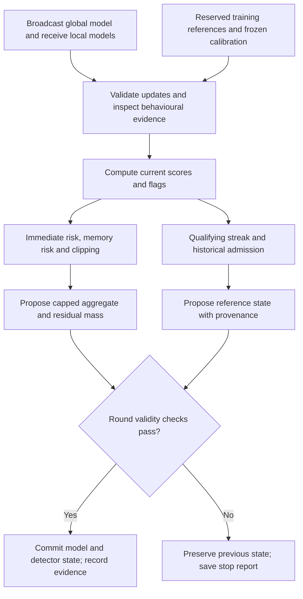

# Fed-MediShield — research purpose, architecture, implementation record and unresolved failures

**Document completed:** 4 October 2026, Asia/Kolkata. **Evidence cutoff:** the supplied contrast-5 live stop and subsequent cohort-score audit; no new training results are implied by this date.  
**Purpose of this file:** Record what this project was intended to do, why it was selected, what was implemented, what the evidence supports, and what remains unsuccessful.  
**Current instruction:** Implementation work is paused. This document does not authorize another redesign, training run, threshold change, baseline run or replacement of project files.

The project remains **server-side backdoor defence for federated intrusion detection on heterogeneous medical-IoT traffic**. We have built substantial experimental infrastructure and obtained useful failure evidence. We have **not established a reliable, generalizing Fed-MediShield defence**, superiority over the relevant baselines, or readiness for a publication claiming those results.

Throughout this document:

- **Intended** means a research objective or proposed mechanism.
- **Implemented** means the mechanism exists in a particular code version; it does not establish security effectiveness.
- **Observed** means a result appears in the supplied console output or saved experimental artifacts.
- **Replay evidence** concerns decisions on previously recorded updates. It is not the outcome of training a new defended model.
- **Unresolved** means the available evidence does not settle the question.

## 1. Why we selected this topic, what gaps motivated it, and what we aimed to implement

### 1.1 The actual problem we wanted to solve

An intrusion detection system classifies network traffic as benign or as an attack category. In federated learning, several clients train a shared IDS without pooling all their raw training records at the server. A compromised training client can poison part of its local data or manipulate its submitted model update.

A **targeted backdoor** is particularly important here: the attacker wants selected attack traffic, when carrying a trigger, to be classified as **Benign**, while ordinary traffic classification remains reasonably accurate. Consequently, a global model can have acceptable clean accuracy and still fail almost completely when the trigger is present.

The second difficulty is that legitimate clients are different. A client with mostly DoS traffic can produce an update very different from a client with mostly benign or MQTT traffic. This legitimate variation is called non-IID heterogeneity. A defence that treats every unusual update as malicious can remove useful learning, especially for less common attack classes.

Our research question therefore became:

> Can an FL server identify and limit targeted poisoning while preserving useful contributions from heterogeneous honest clients, and maintain historical references without automatically learning suspicious behaviour as normal?

This is a joint **security–utility–retention** problem. Low attack success by itself is insufficient if the defence stops learning. High clean accuracy by itself is insufficient if triggered attacks are accepted. High detector recall by itself is insufficient if the false alarms suppress many legitimate clients.

The medical-IoT setting supplies the application motivation: false negatives can leave malicious device/network activity undetected, while false alarms and loss of rare-attack recall can make an IDS unsuitable for operational use. Our experiments concern network-flow classification. They do not establish patient-outcome improvements or clinical deployment safety.

### 1.2 The four base papers and their different roles

The numbering below follows the discussion's roles: Hassan is the domain survey, Pathak the early-detection paper, Bi the hierarchical defence, and Zhang the stealthy attack paper. Local PDF/extracted-text filenames used different numbering, so **paper titles and authors are the authoritative identifiers**.

| Base work | What it contributes to the project motivation | What it does not establish for our project |
|---|---|---|
| **Syed Rizwan Hassan et al., “A comprehensive survey on intrusion detection in internet of medical things: Datasets, federated learning, blockchain, and future research directions.”** *ICT Express*, 11, 1291–1310, 2025. [R1] | Domain-specific IDS requirements, dataset limitations, imbalance, resources, privacy and future research directions. | It is a survey, not a defence algorithm whose performance we have improved. |
| **Jaya Pathak et al., “Early round detection protocols: Strategies against untargeted adversarial attacks in federated learning network.”** *Computer Networks*, 279, 112098, 2026. [R2] | Early identification of poisoning; Fed-ADH and Fed-CD; the need to examine selection and exclusion policies. | Its reported untargeted-poisoning results are not targeted-backdoor results on CICIoMT2024. |
| **Qinglin Bi et al., “HFLMND: Toward robust and efficient hierarchical federated learning via malicious node detection.”** *Knowledge-Based Systems*, 336, 115270, 2026. [R3] | Geometric similarity, clustering, historical suspicion, and the interaction between detection and aggregation. | It does not lack history, and our flat client–server simulator does not reproduce its hierarchical threat model. |
| **Maozhen Zhang et al., “DualVeil: Persistent and invisible backdoor attacks in federated learning via dual optimization.”** *Knowledge-Based Systems*, 339, 115650, 2026. [R4] | Persistent, subtle backdoors can preserve the main task and exploit stable model parameters. | Our fixed feature-space trigger is not a reproduction of DualVeil, and final-layer inspection has not been shown to defeat it. |

### 1.3 Hassan: domain relevance and evaluation gaps

**What the paper says.** Section 15.3 discusses data imbalance and the shortage of realistic, detailed IoMT datasets. Privacy, patient confidentiality and access restrictions make real medical-network attack data difficult to obtain. The survey also identifies resource constraints, explainability, scalability and adversarial robustness as concerns. [R1, especially §§15.1–15.5]

**The gap we chose to investigate.** A defence evaluated only through overall accuracy on generic data may not establish that it preserves useful intrusion detection for heterogeneous medical-device traffic. We wanted a domain-relevant evaluation that reports per-class performance, false alarms, runtime and poisoning resilience together.

**Our proposed response.** Start with CICIoMT2024; preserve multiclass attack labels; simulate heterogeneous clients; measure both attack mitigation and ordinary IDS utility; subsequently extend to additional independent datasets.

**Necessary qualification.** Using CICIoMT2024 does not “solve the dataset gap.” We initially used only selected Wi-Fi/MQTT CSVs. Dirichlet label partitions simulate statistical heterogeneity; they do not reconstruct hospitals, device ownership, medical workflows or natural temporal drift. The wider literature screening also identified prior medical-IoT evaluation, including D3-FLIDS. Therefore, “we use a medical dataset” is not by itself a novel contribution.

### 1.4 Pathak: early detection, forced selection, and a different attack objective

**What the paper implements.** Fed-ADH compares client changes with the global model using a Hausdorff-distance construction. Its Algorithm 1 identifies a suspect using an argmax over the distances and describes removing that suspect. The displayed rule does not include a calibrated “no malicious client detected” outcome. Fed-CD is a separate procedure: it temporarily drops clients on a round-robin schedule to assess their contributions. These are related but different mechanisms. [R2, §3.2.3/Algorithm 1 and §3.2.4/Algorithm 2]

**Our interpretation of the design risk.** A ranking always has a maximum, including when all observations are benign. Without a suitable rejection threshold or clean-null check, “most different” need not mean “malicious.” Similarly, deliberately withholding a client for diagnosis is not the same as having evidence that its update is poisoned. This motivated explicitly measuring clean-run false alerts and retained honest influence.

**The paper's stated scope and limitation.** Its experiments concern untargeted poisoning on a heart-disease prediction dataset. Its conclusion identifies evolving adaptive adversaries as an unaddressed direction and proposes further adaptive/Sybil-related work. [R2, §4.1 and §6]

**Our proposed response.** Study targeted IDS backdoors; allow a round with zero alerts; avoid a compulsory number of rejected clients; detect from round one as well as after a delay; distinguish unusual honest updates from poisoned updates; use reversible influence reduction and explicit recovery.

**Correction to an earlier claim.** “Pathak drops one malicious client every round even when all are honest” conflates the two procedures and overstates an untested comparison. The defensible statement is that their published selection/exclusion rules motivate a clean-only false-positive investigation. We have not reproduced their complete methods under our protocol and shown our method to outperform them.

### 1.5 Bi/HFLMND: history already exists; recovery and weighting are the relevant questions

**What the paper implements.** HFLMND operates in a client–edge–cloud hierarchy. It extracts several similarity features, performs hierarchical clustering into two groups, and applies Historical Suspicion Score Correction. Its suspicion rule is:

$$
s_i^t=s_i^{t-1}+2l_i^t-1,
\qquad l_i^t\in\{0,1\}.
$$

A current benign classification decreases suspicion; a malicious classification increases it. The stated aggregation rule requires the node to be currently benign and have negative accumulated suspicion. [R3, §§4.3–4.4, Eq. 15]

**Our interpretation of the design risk.** A binary partition of naturally heterogeneous participants can require careful handling when several honest groups exist. A cumulative suspicion rule can also create a tradeoff between reacting quickly to an attack and restoring an honest client's influence after a mistake. These are hypotheses to test, not proof that HFLMND fails in those situations.

**What the paper itself lists as limitations.** It discusses computational cost, evaluation limited to three-layer hierarchies with several hundred leaf nodes, and plaintext parameter inspection without formal differential-privacy guarantees. Its future work explicitly includes adaptive weighting and dynamic trust based on long-term behaviour. [R3, §§6–7]

**Our proposed response.** Separate the decision to use an update now from the decision to admit it into protected history. Apply bounded, reversible influence penalties, record recovery, and quantify damage to honest clients.

**Corrections to earlier claims.** HFLMND is not a history-free defence, and describing it as permanently banishing every flagged node is inaccurate: subsequent classifications and cumulative scores can change eligibility. Soft weighting and dynamic historical trust are not wholly absent from its stated research direction. Our current simulator also does not address malicious edge servers or hierarchical collusion, so it is not a complete extension of HFLMND's system model.

### 1.6 Zhang/DualVeil: the threat motivation, not an attack we have defeated

**What the paper implements.** DualVeil is an attack framework. It combines persistent-parameter optimization with trigger-invisibility optimization. Historical parameter stability and current small-gradient regions help identify coordinates where the backdoor is less likely to be overwritten by ordinary training; trigger optimization reduces visual perturbation. The work also considers cooperation among malicious clients. [R4, §§3.2–3.5]

**The gap this exposes for defence research.** A poisoned model need not be an obvious full-model outlier or lose much clean accuracy. A defence needs evidence relevant to targeted behaviour, and its history mechanism must not accept persistent poisoning merely because it becomes consistent over time.

**Our proposed response.** Investigate class-sensitive signals, protected historical references, immediate influence limits, delayed/on-off attacks, and eventually a defence-aware adaptive attack.

**Correction to an earlier claim.** It is not established that attack-to-Benign poisoning necessarily concentrates in the Benign row of the last layer. Earlier layers, biases and distributed parameter changes can encode a backdoor. “Counters DualVeil” would require a faithful DualVeil reproduction or a clearly documented adaptation and matched experiments. Those have not been completed.

### 1.7 What the collection of 91 papers was for

The stored consolidated review records completion of a **first-pass screening of 91 papers**, separately from the four base papers, across four batches. It also states that this was not exhaustive equation-by-equation or code-level auditing of all 91 papers. This supersedes earlier milestone notes written before screening was complete. [E1]

The collection served these purposes:

1. Establish the broader security and FL context rather than relying on four isolated works.
2. Identify close prior work and potential duplication of our proposed ingredients.
3. Understand the datasets, threat models, metrics, plots, baselines and experimental scope expected in this research area.
4. Distinguish author-stated limitations from our own possible extension ideas.
5. Select methods requiring deeper review or faithful reproduction before any novelty claim.

The screening record specifically notes overlap in geometry, history, trust, compact signatures, reference data, readmission and non-IID handling. It names work such as P4P, FedDBC, D3-FLIDS and WeiDetect as relevant comparisons. These observations are literature-screening findings, not results of our reimplementations.

An additional direct overlap is **“FedGrad: Mitigating Backdoor Attacks in Federated Learning Through Local Ultimate Gradients Inspection,”** by Thuy Dung Nguyen et al. It already examines ultimate-layer gradients using a two-layer filtering mechanism. Final-layer inspection cannot therefore be presented as our invention. [R5]

**Our potential contribution was meant to be a demonstrably improved admission/recovery mechanism and its security–utility behaviour, not a claim that history, MAD, final-layer inspection, or medical-IoT evaluation had never existed.** That contribution remains unproven.

### 1.8 What we aimed to implement

1. A shared, reproducible multiclass FL IDS pipeline, beginning with CICIoMT2024.
2. A server-side detector that separates poisoning from legitimate non-IID variation.
3. Class-sensitive inspection rather than reliance on only one full-model distance.
4. Detection that can legitimately flag nobody in a clean round.
5. Immediate attenuation of suspicious updates before aggregation.
6. A protected historical reference that suspicious observations cannot update automatically.
7. An explicit cold-start policy, qualification streak and measured recovery process.
8. Bounded client influence without transferring discarded weight to other clients.
9. Honest-client retention and rare-class recall as first-class outcomes.
10. Evidence against attacks starting immediately, delayed attacks, intermittent attacks and eventually adaptive attacks.
11. Honest comparison with faithful baselines under matched training/data conditions.
12. A complete reproducibility package: data provenance, configurations, seeds, source versions, checkpoints, raw reports and code/results release.

The intended outcome was **lower backdoor success without unacceptable clean-performance or honest-retention loss**. Neither universal superiority nor guaranteed publication acceptance was a defensible promise.

## 2. Selected architecture, algorithms, mathematical definitions and software structure

### 2.1 There have been several algorithms under the same project name

The broad research objective remained stable, but the operational detector changed substantially. A paper cannot describe the original history detector while reporting results from a later behavioural probe detector.

| Stage | Main detection idea | Status of historical references |
|---|---|---|
| Early v2/v3/v4 experiments | Final-layer geometry, class/whole-head scores, risk memory and filtering variations. | Used in proposed/experimental scoring and trust mechanisms, depending on version. |
| Fresh architecture specification | Row-wise temporal signals, robust cohort calibration, separate influence/history gates and capped aggregation. | Intended core research mechanism. |
| Probe/control candidates | Search for suspicious target behaviour using synthetic feature perturbations and clean controls. | Continued to be maintained, but the design emphasis moved to behavioural evidence. |
| Latest implemented `medishield_contrast_5` | Two-fold, peer-relative local-versus-global probability response; clean per-client/per-phase calibration. | Gated and audited, but **not used in the detection score**. |
| Latest `cohort_relative` audit | Additional normalization of saved aggregate scores by peer-score level. | An offline scoring experiment; not promoted to a live defence. |

The remainder of this section separates the intended historical formulation from the latest actual implementation.

### 2.2 System and threat model

The implemented system is a **single-process FL simulation** with a central coordinating server and simulated clients. It is not yet a deployed multi-hospital service or a hierarchical client–edge–cloud system.

The assumptions include:

- The server is trusted and sees individual submitted model states/updates.
- Client identities are stable across rounds.
- Client sample counts and prescribed training budgets are trustworthy.
- The peer cohort is sufficiently honest for robust comparisons to be meaningful; this has not become a proved Byzantine-resilience theorem.
- Labelled server reference examples can be reserved from training data.
- Explicitly known-clean simulated trajectories are available for calibration.
- The defender does not receive the attacker identity, poison mask, actual trigger specification or attack success as inputs to its score.
- The attack generator and evaluator may use ground truth, but those labels are attached to decisions for analysis afterward.

Ordinary secure aggregation that hides individual updates is not directly compatible with this inspection procedure. We have not supplied a differential-privacy guarantee, a private global-scaling protocol, Sybil resistance, or protection against a compromised server.

### 2.3 Notation and ordinary FL training

| Symbol | Meaning |
|---|---|
| $t$ | Federated communication round. |
| $\mathcal S_t$ | Participating clients in round $t$. |
| $\theta_{t-1}$ | Global model broadcast before local training. |
| $\theta_{i,t}$ | Model returned after client $i$ trains locally. |
| $\Delta_{i,t}=\theta_{i,t}-\theta_{t-1}$ | Full-model client update. |
| $n_i$ | Number of client training records in the fixed protocol. |
| $p_{i,t}=n_i/\sum_{j\in\mathcal S_t}n_j$ | Nominal sample-proportional aggregation coefficient. |
| $K_{i,t}$ | Prescribed local optimizer steps. |
| $C$ | Number of traffic classes; currently six. |
| $S_{i,t}$ | Operational anomaly score in the latest candidate. |
| $T_{i,b}$ | Frozen alert threshold for client $i$ and phase $b$. |
| $\gamma_{i,t}$ | Trust multiplier in $[0,1]$. |
| $\kappa_{i,t}$ | Full-update norm-clipping multiplier in $[0,1]$. |
| $a_{i,t}$ | Effective coefficient after trust and clipping. |
| $\mu_{i,c,t},\nu_{i,c,t}$ | Historical vector and norm reference for classifier row $c$. |

For six-class classification, the local empirical loss is cross-entropy:

$$
\mathcal L_i(\theta)=\frac{1}{n_i}\sum_{(x,y)\in D_i}-\log P_\theta(y\mid x).
$$

The ordinary sample-weighted FedAvg update is:

$$
\theta_t=\theta_{t-1}+\sum_{i\in\mathcal S_t}p_{i,t}\Delta_{i,t}.
$$

Each method must train its own subsequent trajectory after aggregation. Reusing another method's future local updates would not reproduce that method's training outcome.

### 2.4 Dataset contract and client construction

The maintained label order is:

| ID | Class | Scope in the supplied six-file selection |
|---|---|---|
| 0 | Benign | Benign traffic. |
| 1 | DDoS | Selected TCP/IP DDoS ICMP training file. |
| 2 | DoS | Selected TCP/IP DoS ICMP training file. |
| 3 | Recon | OS scanning. |
| 4 | MQTT | Malformed MQTT data. |
| 5 | Spoofing | ARP spoofing. |

There are **six classes including Benign**, not six attack categories. The five attack-family labels do not imply that all subtypes in the full dataset were downloaded or evaluated.

The shared interface preserves multiclass labels and derives binary labels for traffic-level detection metrics:

$$
y_{\mathrm{binary}}=\mathbf1[y_{\mathrm{type}}\ne0].
$$

The training loss uses the multiclass target. Collapsing to binary would obscure confusion between attack families and would change the research task.

The latest grouped preparation log reports:

| Source training file | Retained records |
|---|---:|
| `Benign_train.pcap.csv` | 192,732 |
| `TCP_IP-DDoS-ICMP1_train.pcap.csv` | 194,938 |
| `TCP_IP-DoS-ICMP1_train.pcap.csv` | 104,507 |
| `Recon-OS_Scan_train.pcap.csv` | 16,832 |
| `MQTT-Malformed_Data_train.pcap.csv` | 5,130 |
| `ARP_Spoofing_train.pcap.csv` | 16,047 |
| **Total** | **530,186** |

It produced **424,148 training and 106,038 validation rows**, with **45 features** and reported zero shared final feature fingerprints. Earlier pilot runs used much smaller, differently sampled sets, so their accuracy cannot be treated as directly comparable.

Training-derived preprocessing means that any fitted medians, means or scales come from training only. For a standardized feature:

$$
x'_j=\frac{x_j-\widehat m_j}{\widehat\sigma_j},
$$

where the fitted parameters are not recomputed on validation/test data. Pooled training statistics are a declared simulation convenience, not a private production preprocessing protocol.

The grouped split repair addressed exact shared feature representations. It does **not** establish independence between near-duplicates, adjacent flows, devices or sessions. The repeated grouping/scaling passes are a recorded preparation procedure, not a proof that session leakage is impossible.

For simulated label-skew partitions, the intended Dirichlet construction allocates class-$c$ records according to a draw such as:

$$
(\pi_{1c},\ldots,\pi_{Nc})\sim\operatorname{Dirichlet}(\alpha,\ldots,\alpha).
$$

Smaller $\alpha$ generally permits more unequal class allocation. Exact indices, class counts and partition seeds must be retained. A synthetic Dirichlet client is not automatically a real device or hospital. The latest calibration study varied model initialization seeds while retaining its partition; it did not test new partition draws.

**Filename clarification.** `ICMP1_train` and `ICMP_test` can correctly map to the same attack family. The numeric suffix denotes a file/subtype shard under the mapping, not an additional output class. Correct parsing and provenance matter; literal train/test basename equality is unnecessary. Having both splits in one directory is acceptable only if the loader explicitly enforces their roles. The grouped preparation log lists six training files, but that does not retroactively validate every earlier loader.

**Official-test clarification.** The latest runner does not load the official test set. Earlier project iterations did inspect test results. The overall project must therefore not later describe that previously examined test material as never seen during development.

### 2.5 Current neural model and optimization

The latest paired protocol's `StableMLP` is:

$$
45\rightarrow128\rightarrow64\rightarrow6,
$$

with LayerNorm and ReLU after the two hidden linear layers. The final layer outputs six logits. All layers are trained; inspecting classifier rows does not mean freezing the feature extractor.

The current local training uses AdamW, learning rate $0.001$, weight decay $10^{-4}$, two local epochs and batch size 2,048 in the examined runs. Local optimizer state resets for each client training call. Eight clients participate in the current full-participation experiments. Initial weights, local shuffling and other randomness are seeded and recorded.

The random forest diagnostic was retained as evidence that useful class information exists in the tabular features. It is not interchangeable with this parameter-averaging FL experiment: independently fitted decision-tree structures do not provide the same fixed final-layer/update representation. Keeping an MLP was a compatibility/design choice, not evidence that MLPs are intrinsically more accurate on this data.

### 2.6 The intended five-component architecture

1. **Targeted signal extraction:** inspect class-specific update changes and/or class-conditional behavioural changes.
2. **Adaptive screening:** compare evidence with robust cohort statistics and a declared calibration procedure, allowing zero alerts.
3. **Two distinct gates:** reduce current influence when necessary; independently decide whether an observation may update historical references.
4. **Capped aggregation:** apply trust and norm limits without reallocating withheld weight to survivors.
5. **State and evidence:** preserve provenance, histories, risk, scores, weights, errors, runtime and class-level outcomes.

These are logical responsibilities. Merely implementing all five does not establish that the chosen signal detects poisoning.

This diagram describes the latest candidate's decision flow. There is deliberately no arrow from historical references back into the behavioural score, because that dependency does not exist in contrast-5.

### 2.7 Intended historical signal: row-wise magnitude and direction

Let the final classifier be $W\in\mathbb R^{C\times d}$ with bias $b\in\mathbb R^C$. A row representation can include both weight and bias deltas. The latest diagnostic representation accounts for the prescribed local step budget:

$$
u_{i,c,t}=\frac{1}{K_{i,t}}
\left[W_{i,t}[c,:]-W_{t-1}[c,:],\ b_{i,t}[c]-b_{t-1}[c]\right].
$$

This is a **per-step normalized model delta**, not necessarily the gradient of any one batch, particularly under AdamW. It does not remove all differences in local data or optimization.

The original idea used magnitude deviation and cosine divergence from the client's previous reference. A dimensionless magnitude diagnostic now recorded is:

$$
m_{i,c,t}=\left|\log\frac{\|u_{i,c,t}\|_2+\epsilon}{\nu_{i,c,t-1}+\epsilon}\right|,
$$

and, when both vectors have meaningful norm:

$$
d_{i,c,t}=1-
\frac{u_{i,c,t}^{\mathsf T}\mu_{i,c,t-1}}
{\|u_{i,c,t}\|_2\|\mu_{i,c,t-1}\|_2}.
$$

Near-zero vectors do not provide a reliable angle. Missing or uninitialized history must not be replaced by a fabricated valid cosine score.

Earlier sketches combined raw magnitude differences and direction:

$$
D_{i,t}=\lambda_1\left|\|u_{i,t}\|_2-\nu_{i,t-1}\right|+\lambda_2 d_{i,t}.
$$

That is an illustrative design, not the latest operational score. Its terms have different scales, so normalization and channel availability require an explicit contract. Whole-head versus per-class aggregation and averaging versus taking a maximum also change the detector. Those choices cannot be interchanged after calibration.

**Central status distinction:** the latest contrast-5 code records row-wise log-magnitude/directional history diagnostics but does not feed them into the score used to flag updates. We have therefore not demonstrated the originally proposed historical-scoring contribution through the latest experiments.

The blueprint also mentioned a **class-conditional margin shift**. A possible logit-margin definition is $m_c(x;\theta)=\ell_c(x;\theta)-\max_{k\ne c}\ell_k(x;\theta)$, with update effect averaged over a labelled source-class reference set. This expresses the intended targeted-behaviour idea. It must not be substituted into the latest algorithm description: contrast-5 uses the probability-response equations in §2.9, not this logit-margin statistic.

### 2.8 Robust statistics: what MAD provides and what it does not

For a scalar cohort statistic $x_i$:

$$
M=\operatorname{median}_j(x_j),\qquad
\operatorname{MAD}=\operatorname{median}_j|x_j-M|.
$$

A dimensionless robust deviation can be written as:

$$
z_i=\frac{x_i-M}{\max(\epsilon_s,1.4826\operatorname{MAD})}.
$$

A one-sided detector uses the positive part when only increases are considered suspicious. The scale floor prevents numerical explosion when MAD is zero or tiny. The factor 1.4826 is a conventional normal-distribution scale adjustment; it does not turn arbitrary heterogeneous observations into normally distributed scores.

The early threshold sketch $M+k\operatorname{MAD}$, for example $k=3$, was a candidate rule. It did not supply a 5% false-positive guarantee. MAD can reduce sensitivity to some outliers, but a rare honest class, a contaminated cohort, multiple honest clusters and correlated rounds still complicate calibration. The latest implementation uses MAD inside the probe comparison and uses **additional frozen clean-score thresholds** for the final decision.

### 2.9 The latest implemented signal: two-fold behavioural probe contrast

This is the actual detection mechanism in `medishield_contrast_5`. It was introduced because the earlier geometric/history signals did not reliably separate the observed poisoning from honest updates.

**Reference examples.** The server reserves labelled examples from the training partition, divides them into discovery and confirmation folds, and excludes matching feature fingerprints from client training. With the current default, there are 32 selected reference examples per class, split into 16 per class per fold. Neither validation nor official-test labels select the detector's probes or thresholds.

**Probe bank.** A probe $q$ replaces a small group of standardized feature coordinates with a specified value. The bank searches contiguous groups of widths 1, 2 and 4 plus 16 seeded random groups, using levels $-6,-3,3,6$. For the current 45-feature input this gives 588 probes. These are synthetic feature-space stress tests, not a claim that each perturbed row is realizable as valid network packets.

Let $R_s^{(f)}$ be the reference examples of true source class $s$ in fold $f$, where $f=1$ means discovery and $f=2$ confirmation. Let $T_q(x)$ apply probe $q$. Define a model's source-to-target response:

$$
A_{\theta}^{(f)}(q,s,c)=
\frac{1}{|R_s^{(f)}|}\sum_{x\in R_s^{(f)}}
\left[P_\theta(c\mid T_q(x))-P_\theta(c\mid x)\right].
$$

Subtract the previous global model's response from each submitted local model's response:

$$
E_{i,t}^{(f)}(q,s,c)=
A_{\theta_{i,t}}^{(f)}(q,s,c)-A_{\theta_{t-1}}^{(f)}(q,s,c).
$$

This asks whether that local update newly increases a probe-induced tendency to predict target $c$, beyond what the broadcast model already did.

For the **same probe, source and target**, compare client $i$ with the other submitted clients:

$$
B_{-i,t}^{(f)}(q,s,c)=\operatorname{median}_{j\ne i}E_{j,t}^{(f)}(q,s,c),
$$

$$
\sigma_{-i,t}^{(f)}(q,s,c)=
\max\left(0.05,\;1.4826\operatorname{median}_{j\ne i}
|E_{j,t}^{(f)}(q,s,c)-B_{-i,t}^{(f)}(q,s,c)|\right).
$$

The nonnegative score combines a peer-relative excess with an absolute new-effect requirement:

$$
Z_{i,t}^{(f)}(q,s,c)=
\min\left(
\frac{[E_{i,t}^{(f)}-B_{-i,t}^{(f)}]_+}{\sigma_{-i,t}^{(f)}},
\frac{[E_{i,t}^{(f)}]_+}{0.05}
\right),\qquad [x]_+=\max(x,0).
$$

All terms in this equation use the same $(q,s,c)$. The focal client is excluded from its own peer reference. Cases with $s=c$ are excluded from the search because they do not represent a source-to-different-target change.

For each client and candidate target class, discovery chooses one probe/source pair:

$$
(q^*_{i,c,t},s^*_{i,c,t})=
\arg\max_{q,\;s\ne c} Z_{i,t}^{(1)}(q,s,c).
$$

Confirmation evaluates **that exact choice** on the second fold. It does not launch another search when the first choice fails:

$$
C_{i,c,t}=\max\left(0,
\min\left{
Z_{i,t}^{(1)}(q^*,s^*,c),
Z_{i,t}^{(2)}(q^*,s^*,c)
\right\}\right).
$$

The deployed operational score is:

$$
\boxed{S_{i,t}=\max_{c\in\{0,\ldots,C-1\}}C_{i,c,t}.}
$$

**Why we tried it.** It examines a functional consequence of a submitted update, subtracts the previous model's behaviour, excludes self-comparison, and requires evidence on a separate fold. It searches all target classes rather than being told that Benign is the attack target.

**Why it can still fail.** Honest non-IID training also changes class probabilities. Maximizing over many probes and targets can find extreme honest responses. The reference folds are small and may not represent all legitimate clients. Peer scores are dependent and can be distorted by collusion. Separate-fold confirmation reduces a particular selection problem but does not make the result independent, packet-valid, or automatically attack-specific.

### 2.10 Latest calibration: known-clean trajectories, client identity and training phase

The latest calibration uses known-clean sample-weighted FedAvg trajectories for model seeds **42, 44 and 45**. Seeds 44 and 45 were generated as additional clean calibration controls. These runs are training, although they were not presented as new baseline comparison experiments.

The protocol distinguishes an initial phase, rounds 1–3, from the later calibrated rounds. For a stable client $i$ and phase $b$, let $\mathcal C_{i,b}$ contain its full operational scores from the clean calibration trajectories. With the `higher` empirical quantile convention:

$$
T_{i,b}=\max\left(3,Q_{0.99}(\mathcal C_{i,b})+0.25\right),
$$

$$
T^{\mathrm{ref}}_{i,b}=\min\left(T_{i,b},
\max\left(1,Q_{0.90}(\mathcal C_{i,b})+0.25\right)\right),
$$

$$
w_{i,b}=\max\left(1,0.25T_{i,b},1.4826\operatorname{MAD}(\mathcal C_{i,b})\right).
$$

The current alert is $F_{i,t}=\mathbf1[S_{i,t}>T_{i,b}]$. The severity of the threshold exceedance is:

$$
v_{i,t}=\min\left(2,\frac{[S_{i,t}-T_{i,b}]_+}{w_{i,b}}\right).
$$

Thus a tiny exceedance produces a tiny immediate penalty rather than an abrupt minimum 99% attenuation. The flag is still recorded even when the penalty is small.

The clipping envelope is also fitted from clean controls, rather than enlarged by the current live submissions:

$$
B_{i,b}=\max\left(\epsilon,1.25\max_{\text{clean fitting observations in }(i,b)}\|\Delta_{i,t}\|_2\right).
$$

Profiles require the specified clean seeds, matching client identities/counts/local-step budgets and sufficient phase coverage. In the full-participation 15-round setting, each client has only nine initial-phase and 36 later-phase fitting observations across three seeds. These observations are dependent. A high empirical quantile of them is not a reliable universal tail-probability guarantee.

The calibration contract records the exact score definition, probe bank, source/configuration fingerprints, data and partition identities, references, local budgets, software versions, and fitting procedure. This prevents accidental reuse under an incompatible experiment; it cannot make calibration transfer successfully to a new model trajectory.

**The remaining protocol difference is explicit:** thresholds are fitted on unfiltered clean FedAvg trajectories, whereas filter mode changes the global model and hence future local updates. Multi-seed calibration reduces reliance on one initialization but does not remove that difference.

### 2.11 Immediate risk, bounded memory and influence recovery

The latest candidate separates a large current penalty from a small bounded aftereffect. Let $M_{i,t-1}$ be stored memory risk. Let $q_{i,t}=1$ denote a passing, informative, unclipped participation that qualifies for influence recovery. Then:

$$
M_{i,t}=\begin{cases}
\min(M_{\max},M_{i,t-1}+\lambda_M v_{i,t}^{2}),&F_{i,t}=1,\\
(1-r)M_{i,t-1},&F_{i,t}=0\text{ and }q_{i,t}=1,\\
M_{i,t-1},&\text{otherwise}.
\end{cases}
$$

$$
I_{i,t}=\lambda_I v_{i,t}^{2},\qquad
\gamma_{i,t}=\exp[-(I_{i,t}+M_{i,t})].
$$

The examined defaults are:

$$
\lambda_I=\ln100,\quad
\lambda_M=M_{\max}=\ln1.25,\quad r=0.5.
$$

At one full penalty-width of exceedance, the immediate trust factor is $0.01$. Stored memory alone can reduce a later passing update's trust only as far as $e^{-\ln1.25}=0.8$. Each qualifying passing participation halves that stored risk. A client earns no recovery merely by being absent. An uninformative or clipped update does not earn recovery under this rule.

This change was intended to avoid permanent near-zero influence after a false alarm. It introduces a tradeoff: quicker recovery can also benefit intermittent attackers. It is a chosen candidate policy, not a proof of safe recovery.

**Correction to the original wording.** The earlier sketch $S\leftarrow S+(D-\tau)^2$ was a quadratic accumulation, not an exponential increase. Subtracting a fixed $0.2$ per round was linear recovery, not “sub-linear recovery.” The latest rule has quadratic immediate severity, exponential trust attenuation and multiplicative memory decay. Those are distinct operations.

For completeness, that earlier proposal was:

$$
S_i^t=\begin{cases}S_i^{t-1}+(D_{i,t}-\tau_t)^2,&D_{i,t}>\tau_t,\\
\max(0,S_i^{t-1}-0.2),&D_{i,t}\le\tau_t,
\end{cases}
\qquad \gamma_{i,t}=\frac{1}{1+\exp(S_i^t-\beta)}.
$$

It is retained here as design history. It is not the current formula. In particular, a finite-$\beta$ logistic factor is below one even at zero suspicion, whereas the later exponential-risk factor equals one when both current and memory risk are zero. Sample weighting and a defined residual-mass policy were also necessary to complete the early aggregation sketch.

### 2.12 Historical admission, initialization and slow updating

Current influence and reference admission are different decisions. A slightly downweighted update may still be forbidden from modifying history.

For a classifier row, a hard-gate qualifying observation requires finite/informative row data, score at or below the stricter reference threshold, no clipping, and trust at least $\gamma_{\mathrm{ref}}=0.8$. Write:

$$
P_{i,c,t}=\mathbf1[\text{row informative},\ S_{i,t}\le T^{\mathrm{ref}}_{i,b},
\ \kappa_{i,t}=1,\ \gamma_{i,t}\ge\gamma_{\mathrm{ref}}].
$$

The streak counts **qualifying participations**, not elapsed calendar rounds:

$$
h_{i,c,t}=\begin{cases}
h_{i,c,t-1}+1,&P_{i,c,t}=1,\\
0,&P_{i,c,t}=0\text{ on a participation}.
\end{cases}
$$

Absent clients leave their stored state unchanged. Once $h\ge L$ with $L=3$, the first reference is initialized from the qualifying buffer:

$$
\mu_{i,c,t}=\operatorname{coordinateMedian}\{u_{i,c,r}:r\in\mathcal B_{i,c,t}\},
\qquad
\nu_{i,c,t}=\operatorname{median}\{\|u_{i,c,r}\|_2:r\in\mathcal B_{i,c,t}\}.
$$

For an established reference, admitted observations use a slow EMA with $\rho=0.1$:

$$
g_{i,c,t}=\mathbf1[P_{i,c,t}=1,\ h_{i,c,t}\ge L],
$$

$$
\mu_{i,c,t}=\mu_{i,c,t-1}+g_{i,c,t}\rho(u_{i,c,t}-\mu_{i,c,t-1}),
$$

$$
\nu_{i,c,t}=\nu_{i,c,t-1}+g_{i,c,t}\rho(\|u_{i,c,t}\|_2-\nu_{i,c,t-1}).
$$

A failed hard qualification freezes existing references, resets the qualification streak and clears an unfinished initialization buffer. The system stores source-round provenance for admitted values.

The planned ablations were no history, ungated EMA, trust-proportional EMA and hard-gated EMA. Under proportional admission the EMA rate is $\rho\gamma_{i,t}$; any persistently positive rate can gradually absorb poisoning. Hard admission blocks that pathway only when suspicious observations fail the gate. An attacker that consistently passes can still establish or contaminate a reference. Honest concept drift can instead make a frozen reference stale.

There is no guaranteed attack-free first round. Probation and a coordinate median of three observations do not prove that an initial reference is honest. The current known-clean **offline calibration assumption** must not be confused with a guaranteed clean online warm-up.

In contrast-5, these history rules are implemented and audited, but the score in §2.9 ignores them. Changing the history policy alone therefore does not establish a mitigation contribution in that version.

### 2.13 Norm clipping, capped coefficients and residual mass

The full-model norm determines the clipping multiplier:

$$
\kappa_{i,t}=\min\left(1,\frac{B_{i,b}}{\|\Delta_{i,t}\|_2}\right),
$$

with explicit handling of near-zero norms. The effective coefficient is:

$$
\boxed{a_{i,t}=p_{i,t}\gamma_{i,t}\kappa_{i,t},\qquad 0\le a_{i,t}\le p_{i,t}.}
$$

The global update is:

$$
\boxed{\theta_t=\theta_{t-1}+\sum_{i\in\mathcal S_t}a_{i,t}\Delta_{i,t}.}
$$

Equivalently:

$$
\theta_t=\left(1-\sum_i a_{i,t}\right)\theta_{t-1}+\sum_i a_{i,t}\theta_{i,t}.
$$

The unused mass remains at the previous global model. It is not redistributed by dividing all surviving coefficients by their sum. This prevents another client from automatically receiving extra coefficient merely because peers were downweighted.

The mathematical bound controls coefficient/norm contribution. It does not guarantee low ASR: a small accepted parameter change can encode an effective backdoor. It also does not bound a client's cumulative influence over an unlimited sequence of rounds. A windowed cumulative influence budget was discussed in the broader research plan but has not been established as a successful implemented contribution.

Full-model training and aggregation continue. Last-layer history is an inspection representation; it is not the only part of the model updated.

### 2.14 Stop checks, rollback, shadow mode and capture

Before committing a filtered round, the latest candidate checks:

$$
\text{flagged fraction}=\frac{\sum_i F_{i,t}}{|\mathcal S_t|},
\qquad
\text{informative mass}=\sum_{i:\,\text{informative}}a_{i,t}.
$$

It stops if the flagged fraction is at least $0.5$, or informative mass is below $0.25$. Proposed state is calculated separately; a stopped round commits neither the global update nor the detector's proposed history/risk changes. The report records the reason and proposed decisions.

This is an invalid-detector/collapse guard. A stop on a clean run is a failed clean-screening outcome, not successful malicious-client blocking. Raising the limit merely to get a completed run would not repair the detector.

- **Filter mode:** applies trust/clipping coefficients if the round passes the validity checks.
- **Shadow mode:** observes detector behaviour while the actual aggregation follows nominal FedAvg. It does not mitigate attacks.
- **Capture mode:** records the broadcast global state and submitted local states for later inspection. A capture is evidence acquisition, not a defended training result.
- **Offline audit:** uses saved scores/states to check a proposed detector rule. It need not rerun local training or inference when all required evidence was saved.

### 2.15 Exact replay and its limits

For a recorded round the valid update is:

$$
\Delta^{\mathrm{recorded}}_{i,t}
=\theta^{\mathrm{recorded}}_{i,t}-\theta^{\mathrm{recorded}}_{t-1}.
$$

A replay may determine what a different detector would flag, admit or weight for that exact round. It can also form a one-round counterfactual aggregate from those updates.

It cannot obtain an alternative full training trajectory by subtracting a newly reconstructed global state from old submitted models. If an alternative defence changes $\theta_t$, the next clients would train from that changed model and normally return different $\theta_{i,t+1}$. Those future local training steps require a fresh live run.

Therefore, **14/15 poisoned submissions detected in replay is a detector observation, not 93.33% attacks prevented and not a measured ASR reduction**. Proposed retention in replay is also not measured retained influence along a fresh defended training trajectory.

### 2.16 Latest rejected cohort-relative correction

The last offline experiment tried to normalize broad round-to-round score-level changes. For raw aggregate score $S_{i,t}$:

$$
p^{\mathrm{peer}}_{i,t}=\operatorname{median}_{j\ne i}S_{j,t},
$$

$$
A_{i,b}=\max\left(1,\operatorname{median}_{\text{clean fitting }t\text{ in phase }b}p^{\mathrm{peer}}_{i,t}\right),
$$

$$
\widetilde S_{i,t}=S_{i,t}\frac{A_{i,b}}{\max(1,p^{\mathrm{peer}}_{i,t})}.
$$

The anchor was fitted only on the fitting clean seeds. Thresholds and widths were then fitted in the new score units with the existing criteria. One alternative formula was evaluated alongside the raw-score control; there was no sweep for a conveniently passing threshold.

This rule failed held-out clean checks and was **rejected**. It is not the current successful deployment rule. Its focal-client exclusion also does not provide independent evidence, because the underlying peer scores already depend on cohort comparisons.

### 2.17 Metrics and exact interpretation

For a validation set of $N$ examples, clean accuracy is:

$$
\mathrm{CA}=\frac{1}{N}\sum_{k=1}^{N}\mathbf1[\widehat y_k=y_k].
$$

For class $c$:

$$
\mathrm{Precision}_c=\frac{TP_c}{TP_c+FP_c},\quad
\mathrm{Recall}_c=\frac{TP_c}{TP_c+FN_c},\quad
F1_c=\frac{2\mathrm{Precision}_c\mathrm{Recall}_c}
{\mathrm{Precision}_c+\mathrm{Recall}_c},\quad
\mathrm{MacroF1}=\frac1C\sum_c F1_c.
$$

Zero-denominator conventions and class supports must accompany the numbers. A high accuracy on the larger natural-prevalence dataset can coexist with low MQTT, Spoofing or DoS recall.

For trigger $T$ and target label $y^*$, exclude records already in the target class:

$$
\mathrm{TTR}=\frac{\sum_{k:y_k\ne y^*}\mathbf1[f_\theta(T(x_k))=y^*]}
{|\{k:y_k\ne y^*\}|}.
$$

In a live attacked model this is the reported ASR under the stated denominator. In a clean model it is a **triggered-target rate**, not evidence of a learned backdoor. The current evaluator also reports conditional ASR restricted to eligible records classified correctly before triggering, with its own denominator.

Update-level ground truth defines $TP_u,FP_u,FN_u,TN_u$ for poisoned versus unpoisoned **submissions**:

$$
\mathrm{DetectionRate}=\frac{TP_u}{TP_u+FN_u},\qquad
\mathrm{UpdateFPR}=\frac{FP_u}{FP_u+TN_u}.
$$

Update detection precision/F1 follow the ordinary confusion-table formulas. An all-clean run has no positive update examples; detection rate is undefined, not zero success. A compromised client can submit an unpoisoned update before its attack begins, so “compromised identity” and “poisoned submission” are separate labels.

Traffic-level IDS FPR is a different quantity:

$$
\mathrm{IDS\ FPR}=P(\widehat y\ne0\mid y=0).
$$

Let $H_t$ denote unpoisoned submissions. Weight retention over the examined rounds is:

$$
\mathrm{UnpoisonedRetention}=100\,
\frac{\sum_t\sum_{i\in H_t}a_{i,t}}
{\sum_t\sum_{i\in H_t}p_{i,t}}.
$$

Use the analogous ratio over poisoned submissions for poisoned retention. This is **coefficient mass**, not the norm of a vector sum; updates can cancel or point in different directions. Lower poisoned retention is useful but not an ASR guarantee.

Honest zero-weight rate counts unpoisoned submissions assigned exactly zero weight. Soft penalties can make influence negligible without producing exact zeros, so zero-weight rate alone is insufficient. Log flags, positive-but-small coefficients, clipping, residual mass and retention together.

Across evaluation seeds, report individual values plus mean and sample standard deviation:

$$
\overline x=\frac1S\sum_{s=1}^S x_s,\qquad
\operatorname{SD}(x)=\sqrt{\frac{1}{S-1}\sum_{s=1}^S(x_s-\overline x)^2}.
$$

Rounds are not independent seeds. Three clean fitting seeds are not five independent successful defence-evaluation seeds.

### 2.18 Software structure and experiment contract

| File/component | Intended/current responsibility | Important status |
|---|---|---|
| `prepare_federated.py` | Audited source selection, grouped split, preprocessing, saved tensors, partition/provenance. | Foundation for current grouped data; exact-overlap control is narrower than session independence. |
| `train_defended.py` | Shared model, local training, poisoning/evaluation helpers, paired experiment protocol. | Must stay compatible with its paired `defenses.py`. |
| `defenses.py` | Baseline implementations and legacy candidate implementations. | Its old class named `FedMediShield` is not the separate latest candidate. |
| `medishield_candidate.py` | Latest candidate calibration, scoring, influence, history state, replay and live workflow. | Latest examined version: `medishield_contrast_5`, revision `multiseed_phase_calibration_1`; failed fresh clean transfer. |
| `medishield_audit.py` | Saved-measurement raw/cohort-relative comparison and held-out-clean checks. | Latest completed audit rejects both rules under the stated screen. |
| Older `data.py`, `train_federated.py`, `train_attacked.py`, `train_centralized.py`, `attack.py` | Earlier preprocessing/training/attack paths. | Results from these paths need their own provenance; do not silently mix them into the current grouped protocol. |
| JSON/CSV/NPZ evidence and local checkpoints | Configurations, source fingerprints, split identities, scores, decisions, captured states, model/detector state and metrics. | Evidence supports inspection/resume only under the appropriate exact contract. |

The latest candidate's checkpoint workflow is: verify contracts; obtain/reuse clean calibration evidence; fit profiles; replay the development capture; check screening criteria; attempt a fresh clean live run; only then attempt the paired attacked live run if the clean checks pass. The latest execution stopped during the fresh clean run, so its attacked live experiment did not occur.

The source archive records version and hashes to prevent mixing files. Atomic checkpoint writes reduce partial-save problems. Resume applies to compatible committed state, not a mechanism to override an intentional scientific stop. A ZIP that omits large local model checkpoints is not a complete resumable research deposit by itself.

The attack helper is separate from the defender. For eligible records $y\ne y^*$, it selects $\lfloor\pi N_{\mathrm{eligible}}\rfloor$ records at poison rate $\pi$, applies a trigger and changes their training label to $y^*$. The selection uses a documented poison/client/experiment seed. The current helper has three synthetic transformations on selected coordinates $J$:

$$
\begin{aligned}
\text{constant: }&T(x)_J=v,\\
\text{additive: }&T(x)_J=x_J+v,\\
\text{blended: }&T(x)_J=(1-\lambda)x_J+\lambda v.
\end{aligned}
$$

Other coordinates are unchanged. Optional model scaling submits $\theta_{t-1}+s(\theta_{i,t}-\theta_{t-1})$. A periodic schedule is active when $t\ge t_0$ and $(t-t_0)\bmod P<A$, where $P$ is the period and $A$ the number of active rounds per period.

The latest examined default scenario uses one attacker among eight clients, 20% poisoning of its eligible records, target Benign, and a constant feature-space pattern on coordinates 0–3. Earlier experiments used different budgets, trigger coordinates and warm-up schedules. Availability of additive/blended/schedule flags does not establish a completed three-trigger or adaptive-attack study. None of these simple helpers is a faithful DualVeil implementation.

### 2.19 Comparison with standard baselines: intended benefit versus established evidence

| Comparator | What it does | What we hoped to add | What we can currently claim |
|---|---|---|---|
| FedAvg | Sample-weighted aggregation without a poisoning detector. | Identify and attenuate malicious influence. | The examined triggers work against it; current MediShield robustness is unestablished. |
| Coordinate-wise median | Robust coordinate aggregation. | Explicit behavioural detection and auditable historical admission. | Median need not produce a client-level malicious/benign decision. Its ASR was high in the supplied immediate-attack run. |
| Trimmed mean | Removes a declared number of extreme values per coordinate before averaging. | Preserve honest client influence using attack-relevant evidence. | Coordinate trimming is not whole-client detection; scalar client FPR must not be invented. |
| Krum | Scores updates by nearby squared distances and selects one. | Low ASR while preserving more honest diversity and class utility. | Krum already achieved very low ASR in the supplied grouped-data runs. We have not beaten that security–utility result. |
| FedGrad | Published ultimate-layer gradient inspection with its own filtering/trust mechanisms. | A justified admission/recovery improvement under a matched protocol. | The earlier custom heuristic labelled FedGrad was not a faithful reproduction; no valid superiority claim exists. |
| HFLMND | Hierarchical geometric clustering plus historical suspicion. | Study a different influence/admission policy under explicit assumptions. | Our current flat system does not reproduce its whole architecture. |

For reference, single Krum uses a score of the form $s_i=\sum_{j\in N_i}\|\Delta_i-\Delta_j\|_2^2$, with $N_i$ the $n-f-2$ nearest other updates, and selects the minimum-scoring update. Its theoretical conditions are not a universal guarantee for arbitrary non-IID local-model updates. Selecting one client does **not** mean predicting that all other clients are attackers. [R6]

The intended advantage of MediShield was a better joint outcome on security, retained honest contribution, minority-class utility, recovery and cost. “Best among all defences” remains an untested aspiration, not an architectural property.

## 3. What we were able to achieve

### 3.1 Concrete engineering achievements

1. **A runnable local FL simulation.** The Windows environment successfully trained centralized, IID-FedAvg and non-IID-FedAvg models and produced saved results. The environment and unit checks established software functionality within their scope.
2. **Real-data ingestion with a stable six-class contract.** The project moved beyond generated toy data to selected CICIoMT2024 training files, retained multiclass labels, and clarified numbered filename mapping.
3. **A better-controlled development split.** The newer loader detected 32,302 shared train/validation feature fingerprints in an earlier processed file. The grouped rebuild eventually reported zero shared final fingerprints. This corrected a concrete data-integrity failure.
4. **Training-only preprocessing and protected reference roles.** The current design separates client training, server training-derived references and validation. It documents the pooled-statistics assumption.
5. **Meaningful baseline and feature diagnostics.** We compared centralized/IID/non-IID learning, tried longer schedules and different optimizers, and used a random forest to show that substantial class information was recoverable from the supplied features.
6. **Working attack injection and evaluation.** Multiple runs showed high triggered-target success on attacked FedAvg, establishing that the examined feature-space attack was effective against the corresponding undefended models.
7. **A functioning comparison harness.** Later runs used a common training/data protocol for FedAvg, median, trimmed mean and Krum, with distinct model trajectories. Older mislabelled heuristics were identified rather than accepted as faithful baselines.
8. **Separate candidate and baseline code paths.** The latest candidate can be examined without rerunning a baseline suite or confusing its class with an older `FedMediShield` implementation.
9. **Bounded influence mechanics.** The candidate explicitly calculates nominal shares, immediate risk, bounded memory, clipping and residual mass. These mechanisms are auditable even when the detector itself is ineffective.
10. **Reference admission and provenance infrastructure.** Initialization buffers, qualification streaks, slow EMA updates, frozen admissions and source-round tracking exist in code.
11. **Exact update capture and replay.** Saved global/client states allow detector analysis without rerunning all client training, subject to the fixed-trajectory limitation.
12. **Cached probe-score reuse.** Later investigations reused verified measurements rather than repeating the same probe inference. The calibration/review contracts detect incompatible artifacts.
13. **Rollback and failure preservation.** Invalid rounds are stopped before model/state commit and produce a failure report. This makes failure visible instead of silently reporting an impaired model as a completed success.
14. **More informative metrics.** Reports distinguish clean TTR from attacked ASR, update FPR from traffic FPR, and flags from actual retained influence. Per-class recall and confusion matrices expose failures hidden by accuracy.
15. **Independent-seed checks of calibration.** The latest offline audit excluded one clean seed at a time and revealed transfer problems that in-sample calibration had hidden.
16. **A documented research scope and literature screen.** The 91-paper screening, four base-paper analysis and project protocols identify candidate contributions and substantial overlap with prior work.

These achievements are reusable foundations. They are not equivalent to having solved backdoor defence.

### 3.2 Empirical findings that are useful, with their limits

- The clean random-forest diagnostic on the earlier grouped development subset obtained **96.92% validation accuracy and 96.67% macro-F1**, with high recall across the six classes. This showed that a roughly 79% neural result was not an established upper limit of the features. It did not establish a federated RF defence or performance on the later full-data split.
- The earlier 200-round, two-local-epoch Adam diagnostic obtained **90.20% centralized validation accuracy**, **87.03% IID-FedAvg**, and **77.39% non-IID-FedAvg**. The corresponding one-local-epoch run obtained **88.15%, 78.95% and 76.94%**. This supports separating optimization and heterogeneity effects; it does not identify a single causal explanation for the gap. The `_hi` archive's metadata confirms two epochs even though its basename still contains `e1`.
- On the newer grouped protocol, clean FedAvg reached **84.77% CA / 70.59% macro-F1**; attacked FedAvg reached **85.09% CA / 70.88% macro-F1 / 93.14% ASR** in the supplied 15-round seed-42 run. High ordinary accuracy therefore did not expose the backdoor.
- Krum reached **84.98% CA / 74.85% macro-F1 / 0.25% ASR** under the matched immediate attack, and about **0.31% ASR** under the supplied delayed attack. These are useful one-seed baseline outcomes, not universal robustness evidence.
- Contrast-5 replay on the recorded seed-42 attacked trajectory flagged **14/15 poisoned submissions**, falsely flagged **3/105 unpoisoned submissions**, and proposed **98.48% unpoisoned retention** with **6.79% poisoned retention**. This shows useful separation on that familiar captured trajectory. It did not survive the fresh clean-transfer check and did not yield a completed live attacked contrast-5 model.
- The latest audit reproduced the old raw-score results and tested one alternative using saved evidence only. Its rejection is an informative result: the selected normalization did not solve clean calibration transfer.

### 3.3 What the tests establish

Self-checks exercised invariants such as finite inputs, nominal coefficient bounds, residual mass, immutable inputs, reference admission, source bookkeeping, checkpoint round trips and shadow/FedAvg identity. Passing those checks is useful evidence against specific programming errors.

They do not establish low FPR on real heterogeneous clients, low live ASR, correct identification of adaptive attackers, or a publishable advantage. The user-side runs remained necessary and revealed failures that invariant tests cannot detect.

## 4. What failed, the remedies we tried, and what remains unresolved

### 4.1 Reading the failure record correctly

The history below includes the documented methods and substantial experimental changes visible in the supplied logs, archives and project records. It is not a claim that every unpublished local edit or interrupted terminal session was preserved. Values from different datasets, splits, architectures, attack budgets or versions are **not one controlled leaderboard**.

There are three different kinds of failure:

1. **Programming/integration failure:** unsupported CLI flags, version mismatch, invalid checkpoint handling or bookkeeping exceptions.
2. **Experimental-protocol failure:** leakage risks, incomparable splits, mislabelled baselines or incorrect metric interpretation.
3. **Scientific failure:** code runs as specified but its detector misses attacks, rejects honest clients or fails to generalize.

Fixing the first two is necessary. It does not automatically fix the third.

### 4.2 Full history of the principal attempts

#### Attempt 1 — generated data and early geometric defences

**Purpose:** establish that FL, backdoor injection, aggregation and filtering could execute end to end before using the real dataset.

Early generated-data runs reached approximately 99% clean accuracy; some v1/v2 runs sharply reduced ASR in that artificial setting. This was encouraging as a pipeline check, but it did not carry over to CICIoMT2024. The synthetic generator made a different classification problem and could not justify expected real-data accuracy or real-world robustness.

**Unresolved outcome:** the early high numbers were never evidence that the medical-data defence was already solved.

#### Attempt 2 — CICIoMT pilot with MediShield v2

The 12-round seed-42 pilot produced identical reported FedAvg/MediShield outcomes: clean CA **67.92%**, attacked CA **67.47%**, and attacked ASR **99.67%**. Adding diagnostics confirmed that the defence did not change the outcome meaningfully.

**What failed:** the selected detection/enforcement path did not prevent the examined backdoor. More logging was useful for diagnosis, but was not a mitigation change.

#### Attempt 3 — stronger v3 filtering

In the 12-round pilot, attacked ASR fell to **7.08%**, but attacked clean accuracy fell to **62.49%**. Clean MediShield accuracy was **66.45%**, compared with clean FedAvg **67.92%**.

**What this showed:** an aggressive intervention could reduce this one attack result, but at a cost to ordinary learning. It did not demonstrate the required joint security–utility improvement or reliability across seeds.

#### Attempt 4 — v4 scoring-scope and risk-memory ablation

We compared `all`, `whole` and `classes` scoring with memory on/off in clean runs.

| Clean setting, seed 42 | CA | Macro-F1 | DoS recall | Honest alert | Retention |
|---|---:|---:|---:|---:|---:|
| All/class scoring, memory on | 66.07% | 60.39% | 0.50% | 25.00% | 66.60% |
| All/class scoring, memory off | 65.79% | 59.76% | 0.63% | 12.50% | 83.26% |
| Whole scoring, either memory setting in this run | 67.92% | 65.34% | 87.90% | 0.00% | 100.00% |

**What failed:** the class-sensitive configuration nearly erased DoS recognition in a clean experiment. Turning memory off reduced some suppression but did not restore DoS recall. Whole-head scoring preserved utility better but subsequently missed substantial poisoning.

#### Attempt 5 — whole-head v4 across seeds and longer validation runs

At 12 rounds, attacked MediShield ASR was **63.34%** for seed 42 and **99.94%** for seed 43. Moving to a training-derived validation split and 30 rounds gave **11.25%** ASR for seed 42 but **90.08%** for seed 43.

**What failed:** a favourable seed-42 outcome did not generalize. Longer training and a cleaner evaluation role did not turn the detector into a stable defence. Different ASR results across seeds also made choosing only the best seed unacceptable.

#### Attempt 6 — diagnose low clean accuracy through centralized/IID/non-IID comparisons

We separated the classifier-learning problem from poisoning. At 30 rounds, the original clean diagnostic reported about **78.69% centralized**, **74.54% IID-FedAvg**, and **74.40% non-IID-FedAvg** validation accuracy.

**Why we did this:** if centralized training is also poor, blaming only non-IID aggregation or the defence is incomplete. These experiments helped distinguish baseline optimization from defence damage.

**What remained:** this was a diagnostic comparison, not a successful defence and not proof of a fixed irreducible accuracy limit.

#### Attempt 7 — Adam and longer schedules: 30, 100 and 200 rounds

Adam at learning rate $0.001$ gave 30-round validation CA of **79.01% centralized**, **77.74% IID**, and **75.44% non-IID**. At 100 rounds the final values were **88.70%, 78.17% and 76.72%**. Centralized validation temporarily reached **89.70% at round 95**, but choosing a checkpoint requires a declared validation-selection rule.

The two 200-round runs were **200 rounds at seed 42, not 200 random seeds**:

| Local epochs | Centralized CA / F1 | IID-FedAvg CA / F1 | Non-IID-FedAvg CA / F1 |
|---|---:|---:|---:|
| 1 | 88.15% / 86.72% | 78.95% / 77.56% | 76.94% / 73.79% |
| 2 | 90.20% / 89.09% | 87.03% / 85.90% | 77.39% / 74.68% |

**What improved:** some clean learning recipes improved, especially centralized/IID.

**What did not:** non-IID performance remained substantially lower, and none of these clean-only changes supplied an attack discriminator. Changing local epochs also changes aggregation cadence, optimizer-state resets and example presentations, so it is not an isolated test of one cause.

#### Attempt 8 — five-seed v4 defence checkpoint

We ran seeds 101–105 with the longer recipe. The aggregate final results were:

| Condition | CA, mean ± sample SD | ASR/TTR, mean ± sample SD |
|---|---:|---:|
| Clean FedAvg | 77.49 ± 0.66% | 23.81 ± 22.77% TTR |
| Clean v4 | 77.51 ± 0.41% | 24.95 ± 23.07% TTR |
| Attacked FedAvg | 77.68 ± 0.39% | 98.20 ± 2.51% ASR |
| Attacked v4 | 76.66 ± 0.91% | 97.95 ± 2.63% ASR |

**What failed:** the defence offered essentially no meaningful attack mitigation across these runs, while losing clean utility under attack. This is stronger negative evidence than a single successful pilot seed. It is an old-v4 result, not a five-seed evaluation of the latest candidate.

#### Attempt 9 — fresh project and stricter pipeline checks

We restarted the implementation structure, kept the topic, added tests, retained dual labels, grouped duplicates, trained on a development subset and kept the official test out of that runner. Fourteen tests passed in the supplied setup log.

**What improved:** implementation discipline and data contracts.

**What remained:** the fresh 30-round MLP still ended around **79.36% centralized**, **76.50% IID**, and **75.36% non-IID** validation CA. A new folder and stronger tests did not remove the statistical/model problem.

#### Attempt 10 — lower learning rate, random forest and wider MLP

We tested learning rate **0.0003**, a **200-tree random forest**, and a wider **128/64** MLP.

- Lower-rate centralized training ended at **78.42% CA / 77.05% F1**.
- Random forest obtained **99.48% training CA**, **96.92% validation CA**, and **96.67% validation F1** on that development split.
- Wider MLP ended at **78.65% CA / 77.26% F1**, with temporary validation CA around **87.69%** in an earlier round.

**What failed:** changing only learning rate or width did not produce a stable high neural baseline. Random forest identified a useful diagnostic contrast, but we did not implement an equivalent federated-tree backdoor defence. The cause of neural training instability was not conclusively isolated.

#### Attempt 11 — new source pipeline and apparently stronger centralized results

New code reported **95.83% centralized CA**, but **83.47% macro-F1**, with MQTT recall **42.20%** and Spoofing recall **53.29%**. Validation now contained **106,038 records**, compared with **10,991** in the preceding subset experiment.

**Why the apparent leap was insufficient:** both sample size and class distribution changed, so it was not a controlled model-improvement comparison. Overall accuracy hid rare-class weakness. The code review also found loader safeguards missing, seed/checkpoint problems and mislabelled baseline algorithms.

#### Attempt 12 — repair baseline fidelity and reproducibility

The first code labelled “Krum” summed ordinary distances and averaged seven of eight models; the first “FedGrad” was a custom final-layer heuristic, with an unused saved-history component and order-dependent trust modification. Those results could not support claims against the published methods.

Other identified issues included silently mapping unknown filenames to Benign, MQTT-DDoS substring ordering, insufficient split provenance, missing duplicate-group checks, trigger indices described with unverified feature semantics, a best-checkpoint assignment that needed independent tensor copies, and a standalone unpacking mismatch.

**What we did:** corrected/reviewed baseline formulas, renamed custom heuristics, strengthened shared contracts and seeded comparisons, improved checkpoint handling, and separated old/new pipelines.

**What remains:** code repair alone does not constitute a complete faithful FedGrad/HFLMND/closest-work reproduction. Earlier numbers stay exploratory; they cannot be retroactively upgraded by later source fixes.

#### Attempt 13 — ordinary soft-weight/history MediShield on the newer pipeline

The supplied 15-round attacked run ended at **78.07% CA / 70.34% F1 / 96.40% ASR**. The displayed attacker passed every round. The paired FedAvg attack ended at **95.86% ASR**. Clean candidate results were close in accuracy to FedAvg, but security was not improved.

An earlier 30-round run intermittently printed `BLOCKED` yet ended at **92.81% ASR**. Later logs improved the wording to show flags and actual weights.

**What failed:** occasional flags or low later weights did not remove a backdoor learned earlier. A console label alone was not evidence of zero influence or mitigation.

#### Attempt 14 — maximum class-wise scoring (`--class-score-top-k 1`)

We used the largest class-wise anomaly score to avoid diluting a targeted change in a whole-head average. In the attacked run the ASR jumped to **92.65% by round 3**, before later downweighting, and ended at **87.49%**, with CA **72.84%** and F1 **62.63%**.

The all-clean run falsely flagged the displayed honest client repeatedly and ended at **56.55% CA / 56.30% F1**. Its clean triggered-target rate reached **78.26% in round 8**, despite there being no training attack.

**What failed:** greater sensitivity also amplified legitimate class-specific variation. Early missed poisoning could establish the backdoor, while historical penalties could keep honest influence suppressed. This directly contradicted the intended non-IID-tolerant clean behaviour.

#### Attempt 15 — duplicate audit and grouped-data rebuild

The updated loader refused the old processed data because **32,302 fingerprints overlapped train/validation**. The rebuild iterated grouping/scaling; intermediate shared final fingerprints included 26,653, 5,275 and smaller residuals before reaching zero at pass 11.

**What was fixed:** exact transformed-feature overlap in that rebuilt development dataset.

**What was not fixed:** detector discrimination, near-duplicate/session independence, or attack-subtype coverage. This was a necessary protocol repair, not an ASR-improvement technique. Old results cannot be compared directly with new results as though the split never changed.

#### Attempt 16 — shadow-mode diagnosis and standard robust aggregators

On the grouped data, MediShield shadow mode reported **zero poisoned-update detection** throughout the displayed attacked run while ASR/TTR rose to **93.14%**. Since shadow mode applied FedAvg aggregation, this was a detector diagnostic rather than a failed enforcement intervention.

Median and trimmed mean also ended near **94.79%** and **95.56% ASR** under the same immediate-attack scenario. Krum ended near **0.25% ASR** with strong relative macro-F1.

**What this established:** the attack was not automatically solved by every generic robust aggregator, but an existing baseline already handled that particular run well. MediShield needed evidence of additional value; it could not simply claim standard defences fail.

#### Attempt 17 — history checkpoint with filtering and retained-client selection

The clean candidate repeatedly assigned zero weight to **37.5% of honest clients**, ending at **73.72% CA / 70.17% F1**. In the immediate attacked run, ASR stayed low initially but rose to **68.98% in round 8** and **91.18% by round 15**. Honest zero-weight rates were often **42.86%** in attacked rounds.

**What failed:** the defence lost useful honest contributions without maintaining low attack success. The displayed alert-FPR could be zero while clients still had zero influence, exposing why alerts, selection and weight suppression must be reported separately.

#### Attempt 18 — delayed attack beginning in round 8

The delayed history experiment gave final ASR **91.30% for FedAvg**, **0.31% for Krum**, and **0.67% for that MediShield version**. Candidate CA was **85.15%**, but macro-F1 **72.23%**, below Krum's **74.58%**, and about **28.57% of unpoisoned clients** had zero weight in later rounds.

**What improved:** that version could suppress the displayed delayed attack after earlier clean training.

**Why it was not sufficient:** it had already failed an attack starting immediately and harmed clean participation. Success after an unpoisoned prefix did not establish cold-start security. It also did not demonstrate an advantage over Krum in the matched result.

#### Attempt 19 — later release suite and no-history controls

The uploaded `medishield_release_seed42.zip` contains a later revised candidate, so its results must not be confused with Attempt 18. It reported candidate ASR **92.95% for immediate** and **90.47% for delayed** attacks, with **zero poisoned-update detection** in both. The clean candidate retained high coefficient mass, but that retention also extended to poisoning.

Its history-`none` controls produced the same final CA/F1/ASR as the corresponding hard-history runs. The archive records **14 poisoned history admissions** in the immediate hard-history case and **8** in the delayed case.

**What failed:** the revisions did not preserve the earlier delayed-attack success, and history controls did not demonstrate a useful mitigation contribution. The admission gate was only as reliable as the signal authorizing it.

#### Attempt 20 — per-model synthetic probe search and confirmation

We introduced targeted probe searching to obtain functional evidence beyond raw geometry. In the probe-only clean run, **50–100%** of honest clients were flagged in many rounds, and the model stalled around **76.00% CA / 44.49% F1**. The attacked run ended near **8.41% ASR**, but F1 was only **44.03%** and honest-update FPR reached **100%** in several rounds.

**What failed:** low ASR accompanied a damaged/stalled learner. The detector treated ordinary responses as attacks and removed most useful training. That cannot be presented as successful protection of an IDS.

#### Attempt 21 — matched clean controls, full-search calibration and collapse stop

The next version fitted **13 clean controls**, searched all six targets, added control self-exclusion and calibrated the search procedure. In the first clean round it still flagged **87.5%** of clients and proposed only **0.031326** effective mass, below the **0.25** minimum. It correctly stopped before applying the update.

**What failed:** clean-control calibration did not capture the honest variation encountered by the live submissions. The guard exposed the failure; the guard itself was not the cause of poor discrimination.

#### Attempt 22 — separate candidate, score/envelope audit and direct-score calibration

We separated `medishield_candidate.py` from the legacy defence class and added capped influence, a distinct admission gate, provenance, captures and auditable score channels. One examined candidate calibrated a **maximum envelope over supported channel subsets** while deploying a particular complete score.

Where all deployed channel combinations are covered:

$$
\mathrm{CalibrationEnvelope}\ge\mathrm{Score}.
$$

Calibrating the larger envelope can make live thresholding more conservative. It is a methodological mismatch/clarity issue, but does not prove that replacing it will detect attacks.

The discussed direct-Score 95th-percentile check yielded **13 false alerts among 120 clean client-round observations (10.83%)** and **zero detected poisoned updates** on the examined trajectory. The separate candidate's archived live seed-42 output also ended at **93.14% ASR**, with no poisoned updates detected and full influence retention. Its evaluator recorded **90 poisoned history-source uses**; these are provenance uses across rows/rounds, not 90 different attackers.

**What failed:** correcting the calibration statistic did not create a discriminative signal. Freezing history did not prevent contamination when poisoned observations passed admission.

#### Attempt 23 — capture, exact replay and the contrast-3 behavioural replacement

The new contrast scorer searched **588 probes** per recorded round, used local-minus-global response, peer self-exclusion and separate-fold confirmation. This was a substantive signal change, not just another threshold label.

A replay bookkeeping error first raised `KeyError: (5, 1)`. The ledger needed consistent client/round indexing and complete truth provenance. That error was repaired. The replay then completed but **failed its screening criteria**, so fresh training was skipped.

**What was fixed:** an operational replay bug and the ability to audit the new score correctly.

**What still failed:** the complete proposed policy did not pass the declared development screen. Correct execution did not mean the defence was effective.

#### Attempt 24 — contrast-4 bounded recovery and cached evidence reuse

The recovery revision reused all saved probe-score rounds. On the recorded attacked seed-42 trajectory it detected **14/15** poisoned submissions, falsely flagged **5/105 (4.76%)** unpoisoned submissions, and proposed **92.92% unpoisoned retention**. Clean seed-42 replay showed zero false alerts and 100% retention, but was a fitting trajectory.

The fresh clean seed-43 run falsely flagged **3/8 clients in round 1 (37.5%)**, retained only **57.39%** of their nominal mass, and stopped before round 2 because **4/8 clients were flagged (50%)**.

**What improved:** bounded recovery reduced damaging aftereffects on the familiar replay.

**What failed:** that policy did not transfer to a fresh clean initialization. The cited **46.62%** retention from an earlier discussion must not be substituted for the **92.92%** in this specific replay report; versions and retention definitions must remain attached to their own artifacts.

#### Attempt 25 — contrast-5 multi-seed, phase-specific calibration and continuous penalties

We added clean calibration model seeds **44 and 45** to cached seed 42, fitted separate early/later profiles, froze clean-derived clipping envelopes, and made severity continuous above the alert threshold. It also screened proposed poisoned retention, so many flags with little attenuation could not alone count as a pass.

The familiar attack replay improved to **14/15 detection**, **3/105 FPR (2.86%)**, **98.48% unpoisoned retention**, and **6.79% poisoned retention**. Fresh clean seed 46 had zero flags and full mass in round 1.

Round 2 falsely flagged four of eight honest clients and stopped before application. Its proposed total mass was **0.663071**, or **66.31% retention**. The proposed loss decomposed into about **32.98 percentage points from immediate risk**, **0.71 from memory**, and **0 from clipping**.

**Why this matters:** no trust attenuation was applied in round 1, so this particular fresh failure occurred before feedback from a previously filtered global model. Calibration-versus-filtered-trajectory mismatch remains a general risk, but cannot by itself explain this first failing clean round. Clean seed/early-training score transfer already failed.

The code had reported leave-one-clean-seed-out diagnostics without making them a mandatory pre-live gate. Seed 44 already showed **10% FPR** in that diagnostic. This was a workflow weakness: a warning relevant to transfer did not prevent the expensive fresh attempt.

#### Attempt 26 — offline leave-one-seed-out cohort-relative audit

We examined the raw-score control and the single normalization formula in §2.16, using cached measurements. Every held-out clean seed had to satisfy **FPR ≤5%**, proposed retention **≥90%**, and no would-stop round. The recorded attack also required detection **≥70%**, poisoned retention **≤20%**, and first detection within three poisoned participations.

| Check | Raw-score control | Cohort-relative alternative |
|---|---:|---:|
| Held-out clean seed 42 FPR | 1/120 = 0.83% | 8/120 = 6.67% — fail |
| Held-out clean seed 44 FPR | 12/120 = 10.00% — fail | 9/120 = 7.50% — fail |
| Held-out clean seed 45 FPR | 6/120 = 5.00% | 3/120 = 2.50% |
| Held-out seed 42 retention | 99.91% | 96.48% |
| Held-out seed 44 retention | 95.53% | 94.96% |
| Held-out seed 45 retention | 97.93% | 98.39% |
| Recorded poisoned detections | 14/15 = 93.33% | 14/15 = 93.33% |
| Recorded attack's unpoisoned false alerts | 3/105 = 2.86% | 0/105 = 0.00% |
| Recorded attack's unpoisoned retention | 98.48% | 100.00% |
| Recorded attack's poisoned retention | 6.79% | 18.84% |
| Pass all stated checks | **No** | **No** |

**What failed:** normalizing a shared round-level score shift helped the familiar attacked replay but produced too many false alerts on two held-out clean seeds. It also retained more poisoned weight despite the same detection count. This candidate was rejected without another live run.

These held-out checks are useful development cross-validation, not untouched final confirmation: the data and failures have already informed the design discussion.

### 4.3 Operational errors we also worked through

| Problem | What happened | Resolution or interpretation | What it did not establish |
|---|---|---|---|
| Existing output directory | `FileExistsError` when a run name already existed. | Unique names such as `_retry1` or `_hi` preserved previous results; later compatible resume was added. | A new output name does not change an algorithm or improve a metric. |
| Interrupted long run | `KeyboardInterrupt` appeared inside optimizer/subprocess calls. | The process was interrupted; progress output/checkpoints made long work easier to monitor. | The traceback alone does not prove a Torch optimizer bug or a true deadlock. |
| Missing `--class-score-top-k` | Old parser rejected the argument. | The correct full runner/parser replacement exposed it; `--help` confirmed the flag. | Recognizing a flag does not make its class-wise score scientifically useful. |
| Missing `--version` / `checkpoint` stage / capture arguments | The installed script exposed an older CLI family. | Explicit versioning, matching downloads/source hashes and paired harness checks were introduced. | A mismatched file is a software delivery/integration problem, not evidence about attack defence. |
| Download SHA mismatch | A supplied path did not contain the exact expected bytes. | Verification refused the replacement. Exact source identity was made explicit. | A mismatch alone does not identify why the bytes differ; it should not be bypassed by inventing a new expected hash. |
| Train/validation fingerprint error | The loader stopped on a real overlap count. | Grouped data were rebuilt and rechecked. | The stop should not be removed merely to reuse the old data. |
| Replay `KeyError: (5, 1)` | Historical source lookup used inconsistent bookkeeping. | Client/round provenance lookup was corrected; missing truth became an explicit error. | Repairing the ledger did not change the underlying model's ASR. |
| Unclear result-folder location | Relative output paths caused confusion about where files were saved. | Absolute result paths, explicit ZIP locations and stop reports were printed. | A console success line alone is not a complete results archive. |
| Checkpoint aliasing | Earlier best-state assignment could refer to tensors that later changed. | Independent copies/clones and explicit checkpoint state were required. | An old saved “best model” is not automatically validated by fixing future saves. |
| Ambiguous console labels | `BLOCKED`, `PASSED` and `SELECTED` could be mistaken for equivalent detector claims. | Logging evolved to show flags, nominal/effective coefficients, phase, retention and ground-truth role. | Selection by Krum or coordinate trimming does not create a malicious-client prediction. |
| Repeated full work | Early commands repeated training/review after fixes. | Exact capture, cached inference, contracts and compatible resume were added. | Cached replay still cannot replace live evaluation of a changed aggregate. |

These errors cost time and caused avoidable confusion. The implementation and delivery advice should have been more consistent about exact file versions and supported commands. Repeatedly offering a “final working update” was also too strong: a software revision could be complete enough to run while the research hypothesis still failed.

### 4.4 The central scientific failures that remain

**1. We have not found a reliably generalizing poison-specific signal.** Whole-head geometry missed poisoning; class maxima overreacted to honest class skew; probe responses separated a familiar attacked trajectory but also flagged fresh clean clients. This is the central unresolved problem. More precise risk bookkeeping cannot compensate for unreliable evidence entering the risk rule.

**2. We have not achieved the joint security–utility objective.** Several versions reduced ASR only while suppressing useful honest training. Others preserved clean utility but passed the attack. The required result is a favourable combination, under the same protocol and multiple seeds.

**3. We have not demonstrated robust cold-start defence.** The good delayed-attack result did not carry over to attacks starting immediately. A probation window cannot certify honesty if the detector admits the attack throughout that window.

**4. We have not proved that historical reference gating improves mitigation.** Early memories were contaminated or harmed honest recovery. Later code maintained history without using it in the detection score. The same outputs with/without history in one later suite underline the need to establish an actual causal role before claiming history as the contribution.

**5. We have not established safe honest-client recovery.** Hard freezing can leave stale references; strong memory penalties can trap an honest client; rapid recovery can help on/off attackers. Bounded memory improved a weight-retention calculation but did not prevent the fresh clean FPR failures.

**6. We have not solved calibration transfer.** The latest score profiles fit clean seeds 42/44/45 but failed on seed 46. Even leaving out one fitting seed exposed excessive FPR on seed 44. Small, correlated per-client calibration samples and early-training variability are plausible contributors; the evidence does not isolate a single complete cause.

**7. We have not shown live attack mitigation for the latest contrast-5 policy.** Its workflow stopped in clean round 2. There is no completed attacked seed-46 CA, F1 or ASR to report. Replay fields must remain labelled as replay/proposed quantities.

**8. We have not established superiority over Krum or close published defences.** Krum already performed well against the supplied attack. Retaining more clients is a possible advantage, but it is only valuable if security and per-class utility also hold. A high Krum non-selection rate must not be called a false-positive rate.

**9. We have not established realistic trigger feasibility or adaptive robustness.** Replacing standardized numeric features is an explicitly synthetic attack. Feature names, ranges, types and cross-feature constraints must support any stronger claim about realizable traffic. A patient, colluding or detector-aware attacker has not been adequately evaluated against the latest candidate.

**10. We have not established a stable high-quality classifier for every class.** On the newer grouped protocol, FedAvg's overall CA around 85% concealed weak DoS, MQTT and Spoofing recall. The saved clean seed-42 candidate-equivalent result had approximately **39.67% DoS**, **30.41% MQTT** and **31.91% Spoofing** recall. Defending a weak classifier does not automatically make it an adequate multiclass IDS.

**11. We have not established deployment privacy, scalability or efficiency.** Individual updates and server references are visible, pooled preprocessing is used, and probe search adds work. Logged CPU timings are useful but do not measure a production network, device energy or large-scale hierarchical deployment.

**12. We have not established a novel publishable mechanism.** The ingredients overlap existing work. A convincing contribution requires faithful comparison, an explicit mechanism, a narrower supported claim and evidence that the improvement exceeds a simpler policy. Writing from scratch does not itself establish novelty, and extending ideas does not require copying an author's code; it requires correct attribution and reproducible evaluation.

### 4.5 Complete inventory of remedies and alternatives considered

This index complements the chronological record so that a proposed method is not mistaken for a successful one.

| Family | Methods/settings we worked with | Status |
|---|---|---|
| Data scope | Generated data; CICIoMT pilot; training-derived validation; fresh sampled grouped subset; larger grouped development set. | Implemented/examined; differing scopes prevent direct metric pooling. |
| Data integrity | Filename taxonomy; dual labels; schema checks; training-only scaling/imputation in the relevant pipeline; exact duplicate groups; final float representation checks; reference exclusion. | Significant controls implemented; session independence and full subtype coverage unresolved. |
| Optimization | Centralized vs IID vs non-IID; original optimizer recipe vs Adam; learning rates 0.001/0.0003; 30/100/200 rounds; one/two local epochs; optimizer-reset accounting. | Diagnosed clean learning; did not solve detection. |
| Model capacity | Original small MLP; wider 128/64 MLP; later LayerNorm MLP; random forest diagnostic. | Implemented/examined; no equivalent federated-RF defence result. |
| Geometric evidence | Whole head, class rows, magnitude/norm, cosine/directional change, class top-$k$ and maximum-class rules. | Explored; sensitivity/false-positive tradeoff unresolved. |
| Robust statistics | Median/MAD, scale floors, score standardization, threshold multipliers, complete-score calibration, envelope calibration. | Implemented/examined; no general FPR guarantee. |
| Temporal state | Risk on/off; ungated/proportional/hard/no-history policies; frozen references; qualification streaks; median-buffer initialization; slow EMA; provenance and contamination counts. | Infrastructure implemented; successful security contribution unestablished. Not every policy has a complete matched live study. |
| Influence | Hard selection/rejection in earlier versions; soft exponential/logistic ideas; current immediate risk plus bounded memory; no survivor renormalization; norm clipping; residual old-model mass. | Several implementations examined; bounded influence does not guarantee a harmless update. |
| Behavioural evidence | Class-conditional margin idea; sparse synthetic probes; per-model search; clean controls; full-search calibration; discovery/confirmation; local-minus-global response; leave-one-client-out peers. | Latest implemented detector uses probability contrast; false clean alerts remain. |
| Calibration | Single-seed clean capture; direct score; cached review; multi-seed clean controls; initial/later phases; clean-fitted clipping; continuous penalty widths; held-out-clean checks; cohort-relative normalization. | Latest normalization rejected; fresh transfer unsuccessful. |
| Attack conditions | Immediate, delayed and proposed/available periodic schedules; poison rate; attacker fraction; constant/additive/blended feature transforms; model scaling. | Several immediate/delayed experiments completed; broad sensitivities and realistic/adaptive coverage remain incomplete. |
| Baseline/control methods | FedAvg; coordinate median; trimmed mean; single Krum; Multi-Krum variants; custom heuristic formerly labelled FedGrad; optional/legacy FLTrust-related code paths. | Core reported comparisons exist for the first four. Availability of other code is not a completed faithful benchmark. |
| Closest-work candidates | FedGrad, HFLMND, partial-model inspection, P4P, FedDBC, D3-FLIDS, WeiDetect and other screened work. | Literature/comparator planning; not all reimplemented or fully audited. |
| Experimental efficiency | Shadow runs, exact capture, cached scores, offline replay, leave-one-seed-out arithmetic, progress reporting, atomic checkpoints, resume and source/configuration checks. | Useful infrastructure achieved; does not replace fresh defended training. |
| Validity controls | Clean-only runs; matched data/init/partition; stop/rollback; per-class metrics; retention and poisoned influence; no automatic threshold lowering after failure. | Improved failure detection; final efficacy evidence still missing. |

### 4.6 Supervisor requirements: current completion status

These are the experimental requirements communicated for **this project**. They are not a universal rule that every Q1 journal or IEEE conference mandates the same exact counts.

| Requirement | What exists | What is still missing |
|---|---|---|
| Clean accuracy and precision/recall/F1 | Many development runs and per-class reports. | A validated final defence with consistently acceptable utility under the frozen protocol. |
| ASR before/after defence | Several older matched attack runs; latest replay detection evidence. | Completed live attacked evaluation of a candidate that first passes clean checks. |
| Detection rate and FPR | Update-level and IDS-level metrics now distinguished. | Reliable low-FPR/high-detection behaviour across independent conditions. |
| Five random seeds | An old v4 five-seed study, which failed; three clean calibration seeds. | Five independent evaluation seeds for the same successful frozen final candidate. |
| At least four datasets | CICIoMT selected-file experiments. TON_IoT, Edge-IIoTset, WUSTL-EHMS-2020 and, in another plan, CIC-IDS2017 were considered as additions. | Audited additional adapters and completed evaluations. The final four-dataset roster was not established by these discussions. |
| At least three trigger types | Three simple feature-transform helpers; broader compositional/input-dependent triggers were discussed. | Three justified attack families with matched efficacy/defence studies. Schedules do not count as different triggers. |
| At least four reimplemented baselines | FedAvg, median, trimmed mean and Krum in the shared development protocol. | Final matched comparisons plus faithful close defence reproductions. A custom heuristic cannot count as FedGrad. |
| Non-IID sensitivity | IID/non-IID diagnostics and selected Dirichlet settings. | A systematic frozen-candidate study over declared alpha/partition seeds. |
| Malicious-client ratio sensitivity | Different early/current attack budgets. | A controlled ratio sweep under one frozen protocol. |
| Poison-rate sensitivity | Different values appeared across versions. | A controlled sweep; changing versions at the same time does not isolate poison-rate effects. |
| Ablation study | Score-scope/memory checks; history-none controls; some isolated diagnostics. | Matched ablations demonstrating which final components cause a security–utility gain. |
| Hyperparameter sensitivity | Several development changes and calibrations. | A structured study with declared ranges and no test-based selection. |
| Runtime overhead | CPU training/aggregation/probe/evaluation timings in relevant logs. | Comprehensive overhead and memory comparisons for the final candidate. |
| Scalability | Small simulated cohort, principally eight clients. | Larger client populations, partial participation and resource evaluation. |
| Adaptive attack | Literature motivation and some experimental code/plans. | A documented detector-aware attack evaluated against the final rule. |
| Medical confusion matrices | Available in saved evaluation reports. | Final comparative interpretation, especially rare-class degradation. |
| Reproducible public code and results | Versioned artifacts, scripts, source snapshots and logs. | A curated matching release, appropriate license, full regeneration instructions and DOI-backed deposit where required. |

Four different slices of CICIoMT would not satisfy four independent datasets. Non-medical IoT/IIoT datasets must not be described as clinical datasets. A DOI, source release or broad checklist cannot substitute for a demonstrated research result.

### 4.7 The current answer to “what exactly have we achieved, and what have we not?”

We have achieved **an increasingly auditable experimental platform, several reproducible negative results, evidence that the supplied backdoor works, useful baseline comparisons, and a precise diagnosis that the latest detector does not transfer cleanly across model seeds**.

We have not achieved **a final MediShield mechanism that simultaneously preserves honest learning, detects/attenuates poisoning, lowers live ASR, recovers honest clients safely, and generalizes beyond the already-inspected development trajectory**.

The effort was spent on several different bottlenecks: baseline learning, data integrity, detector discrimination, historical contamination, over-penalization, calibration transfer, reproduction fidelity and execution reliability. Some engineering bottlenecks were corrected. The central attack-versus-honest discrimination and generalization problem remains open.

The current status is therefore **research candidate with failed validation gates**, not “finished defence with a few final bugs.” It is also not evidence that the entire research topic is impossible. The next research decision is deliberately left for discussion after this document; no new implementation or experiment is prescribed here.

## 5. Evidence and references

### 5.1 Base and comparison papers

- **[R1]** Syed Rizwan Hassan, Muhammad Usama Tanveer, Sunil Prajapat and Mohammad Shabaz. *A comprehensive survey on intrusion detection in internet of medical things: Datasets, federated learning, blockchain, and future research directions.* ICT Express 11 (2025), 1291–1310. https://doi.org/10.1016/j.icte.2025.11.005. Source checked: supplied full paper, especially §§15–16.
- **[R2]** Jaya Pathak, Prakhar Mundra, Yash Sejpal, Tanmaya Mahapatra and Amitesh Singh Rajput. *Early round detection protocols: Strategies against untargeted adversarial attacks in federated learning network.* Computer Networks 279 (2026), 112098. https://doi.org/10.1016/j.comnet.2026.112098. Source checked: supplied full paper, Algorithms 1–2, §4.1 and §6.
- **[R3]** Qinglin Bi, Lina Ge, Ming Jiang, Lei Tian and Wenbo Lin. *HFLMND: Toward robust and efficient hierarchical federated learning via malicious node detection.* Knowledge-Based Systems 336 (2026), 115270. https://doi.org/10.1016/j.knosys.2026.115270. Source checked: supplied full paper, §§4.3–4.4 and §§6–7.
- **[R4]** Maozhen Zhang, Mengnan Zhao, Wei Wang and Bo Wang. *DualVeil: Persistent and invisible backdoor attacks in federated learning via dual optimization.* Knowledge-Based Systems 339 (2026), 115650. https://doi.org/10.1016/j.knosys.2026.115650. Source checked: supplied full paper, especially §3 and the experimental scope.
- **[R5]** Thuy Dung Nguyen et al. *FedGrad: Mitigating Backdoor Attacks in Federated Learning Through Local Ultimate Gradients Inspection.* 2023. https://arxiv.org/abs/2305.00328. The primary author record confirms the ultimate-layer/two-layer-filtering scope. Detailed reproduction fidelity remains separate work.
- **[R6]** Peva Blanchard, El Mahdi El Mhamdi, Rachid Guerraoui and Julien Stainer. *Byzantine-Tolerant Machine Learning* (2017 preprint; Krum). https://arxiv.org/abs/1703.02757. The associated published work is *Machine Learning with Adversaries: Byzantine Tolerant Gradient Descent*, NeurIPS 2017. Formula/selection distinction also checked against the project's baseline review records.

The base-paper limitation discussion separates statements explicitly made by authors from risks we inferred. It does not claim to have independently replicated their published experimental results. The additional 91-paper methods mentioned here are drawn from the stored screening record; this document does not newly validate every one of those methods.

### 5.2 Project records used

| Evidence ID | Record | What it supports |
|---|---|---|
| E1 | `Complete_91_Paper_Review_and_Research_Plan.md`, batch reviews, `Fed_MediShield_Project_Decision.md` | First-pass literature scope, overlap warnings and planned studies. |
| E2 | `METHOD_PLAN.md` and fresh milestone `PROTOCOL.md` | Original independent-implementation scope, history hypothesis, data/model contracts and limitations. |
| E3 | Supplied `ciciomt_*` console outputs and archives, including clean ablation and the five-seed checkpoint | Early real-data utility/security failures and training diagnostics. |
| E4 | `ciciomt_baseline_adam_e1_r200_seed42.zip` and `ciciomt_baseline_adam_e1_r200_seed42_hi.zip`: `metadata.json`, `final_summary.json` | Confirms 200 rounds, one versus two local epochs, and their actual final metrics. |
| E5 | Fresh clean/LR/wider-model logs and `feature_diagnostic_seed42.zip` | Neural baseline instability and random-forest diagnostic. |
| E6 | Grouped preparation log; `history_checkpoint_seed42`, `history_delayed_seed42`, baseline console outputs | Data repair, immediate/delayed defence contrast, honest suppression and Krum comparison. |
| E7 | `medishield_release_seed42.zip`: `comparison.csv` | Later revised candidate failure, matching history-none outcomes and poisoned admissions. |
| E8 | `medishield_probe_only_seed42` and `medishield_control_gate_seed42` reports | Probe false positives, learning collapse and first-round controlled stop. |
| E9 | `medishield_candidate_seed42.zip`, supplied score/envelope review discussion, original capture and contrast-3 review | Separate candidate results, provenance, score-calibration issue and replay limits. |
| E10 | `results(1).zip` / `medishield_recovery_seed43` | Contrast-4 replay success and fresh clean seed-43 failure. |
| E11 | `results(2).zip` / `medishield_calibrated_seed46`: calibration, replay summaries, source snapshot, seed-46 `detector_stop.json` | Contrast-5 formulas, multi-seed controls, replay statistics and the exact live round-2 stop. |
| E12 | `Fed_MediShield_Cohort_Audit.json/.md`, `audit_summary.json` and per-observation audit CSVs | Reproduced raw-score results and rejected cohort-relative alternative. |

The latest examined candidate source is `medishield_contrast_5 | multiseed_phase_calibration_1`, SHA-256 `4e8d50b8101a4149e6b0c44eba3fa611c972c72bc64922cff4c70c5e94db47ce`. This identity is included to prevent the report from being mistaken for a description of an older class with the same name.

**Preparation scope:** This file was compiled from source inspection, supplied papers, archived reports and the conversation's experimental record. No new model training, model/probe inference, candidate redesign or baseline experiment was performed to prepare it. Unsupported conclusions have been identified rather than filled with assumed results.
